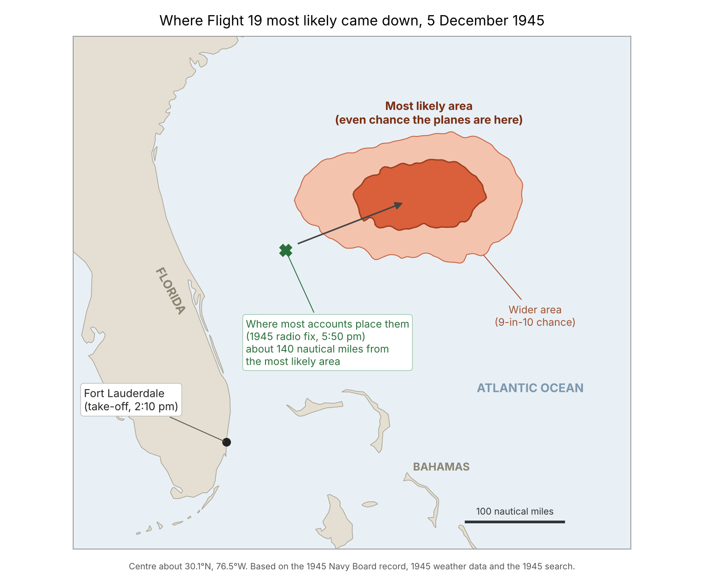

# Flight 19: where the Avengers most likely went down

On 5 December 1945, five U.S. Navy TBM Avenger torpedo bombers on a training flight from Fort Lauderdale got lost, ran out of fuel and ditched in the Atlantic at night. All fourteen men were lost. The planes have never been found.

**Why it happened is well established.** This project estimates **where** it happened, from the Navy's own 1945 records, 1945 weather data and a modern reconstruction of that evening's winds.



## Result

| | |
| --- | --- |
| Most likely centre | **30.1°N, 76.5°W**, off northeast Florida |
| Distance from the 1945 radio fix most accounts use | about 140 nautical miles east-northeast |
| Area with a 50% chance of containing the planes | about 6,400 sq nm (roughly 80 × 80 nm) |
| Area with a 90% chance | about 21,000 sq nm |
| Seabed depth | 26% on the Blake Plateau (600–1,000 m), 21% on the Blake Escarpment (1,000–3,000 m), 52% in the Blake-Bahama Basin (3,000–5,000 m) |
| Chance of finding them with a modern AUV survey* | ~18% in 7 days, ~30% in 14, ~50% in 30, ~72% in 60 |

\*Assumes a fleet sweep of 330 sq nm/day (the pace of the MH370 search) and 90% detection on flat ground, 60% on the escarpment. Replace with a survey operator's real figures.

**This is a probability map, not a location.** Only a seabed survey can confirm it.

## How it works, in brief

1. The flight is re-flown 200,000 times on a computer, each time with slightly different speeds, headings, turn times and winds.
2. Each simulated flight is scored against what was recorded in 1945: the 17:50 radio direction-finding fix, landmarks the flight leader reported, the radio signal fading, the fuel calls and the time of the last transmission.
3. Winds come from ERA5 (ECMWF's reconstruction of past weather), checked against the Miami weather-balloon sounding from that afternoon.
4. Areas searched without result on 6–10 December 1945 count as weak evidence the planes are not there.
5. The surviving flights' ditch points, weighted by how well they match the record, form the map.

The full written case, with sources, timeline, findings, limits and a glossary, is in [`docs/Flight19_Case_File.docx`](docs/Flight19_Case_File.docx).

## What's in this repo

| Folder | Contents |
| --- | --- |
| `maps/` | Simple map (above) and a detailed technical map with simulated tracks, weather and depth contours |
| `data/` | `flight19_zones.kml` (open in Google Earth), `flight19_zones.geojson`, `flight19_probability_grid.csv` (every 2 nm cell: probability, depth band, search order), `flight19_summary.json` |
| `docs/` | Full case file (Word) |
| `code/` | Simulation (`model.py`), fuel model (`fuel5.py`), 1945 search update (`search1945.py`), combine step, map and export scripts |
| `inputs/` | ERA5 winds, 1945 Miami/Jacksonville soundings, 1945 ship weather reports (ICOADS), seabed depths (ETOPO1), coastlines (Natural Earth) |

## Reproduce it

Python 3.9+. From the repo root:

```bash
pip install -r requirements.txt
./run_all.sh
```

This takes about 2 minutes and regenerates everything in `data/` and `maps/`. Intermediate files go to `work/` (ignored by git). The fuel model can be run on its own with `python3 code/fuel5.py`.

## Sources

**Primary records**
- Navy Board of Investigation, *The Disappearance of Flight 19* (NARA microfilm M1657, NAID [146850136](https://catalog.archives.gov/id/146850136)): radio logs, findings, Coast Guard search plans. Not included; 549 pages.
- ICOADS Release 3.1 ship weather reports, December 1945 (NOAA NCEI).
- NOAA IGRA v2 weather-balloon soundings, Miami (USM00072202) and Jacksonville (USM00072206), 4–6 December 1945.
- NAS Fort Lauderdale winds aloft and U.S. Weather Bureau daily maps, 5–6 December 1945.

**Reconstructions and reference data**
- ERA5 reanalysis (ECMWF), via Google's public ARCO-ERA5 store: 900 hPa winds, 14:00–20:00 EST.
- IGRF geomagnetic model (1945 magnetic variation), ETOPO1 global relief (NOAA), Natural Earth coastlines.

**Left out as unverified:** a claim that the tanks were "checked full" (not in the Board's findings), Cuban radio interference attributed to the Port Everglades log (not found in the record), and a 2016 blog report on the USS Solomons deck log.

## Limits

- Not peer-reviewed.
- The spread comes mainly from what nobody recorded: what the crew did after 18:07, and five hours of navigation by compass and dead reckoning.
- The area can only shrink much further with a new 1945 measurement, such as a radar plot or raw direction-finding bearings, which may exist in unfilmed Navy and Coast Guard dispatch files at the National Archives.
- Results depend on stated assumptions (wind error, fuel capacity, radio-fix error shape, survey rates), listed in the case file's technical notes.

## If you find something

The aircraft are U.S. Navy property and protected under the Sunken Military Craft Act. Any discovery must be reported to the Naval History and Heritage Command, Underwater Archaeology Branch, and the site must not be disturbed.

## License

- **Code** (`code/`, `run_all.sh`): MIT, see [`LICENSE`](LICENSE).
- **Maps, data and the case file** (`maps/`, `data/`, `docs/`): [CC BY 4.0](https://creativecommons.org/licenses/by/4.0/). Reuse freely with credit.
- **Third-party inputs** (`inputs/`) keep their own terms: ERA5 (Copernicus licence; attribution required: "Contains modified Copernicus Climate Change Service information"), ICOADS, IGRA and ETOPO1 (NOAA, public), Natural Earth (public domain).

---
Prepared by Tycho, Vestigia Labs, November 2026.
